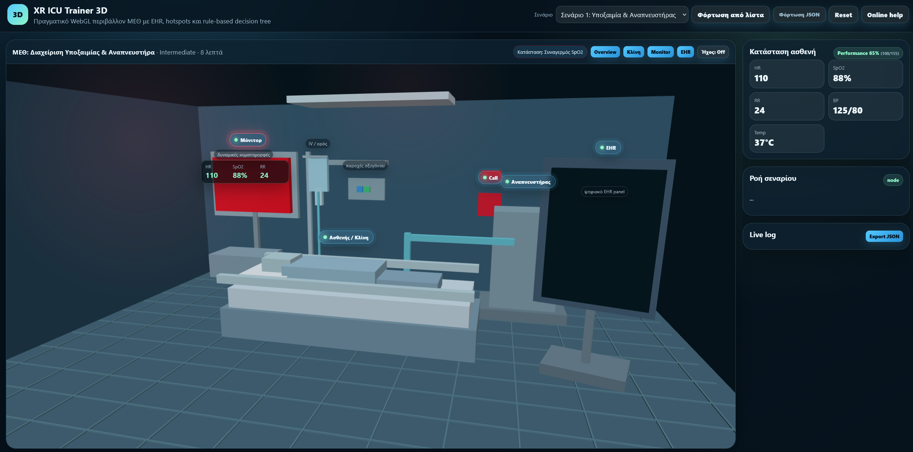
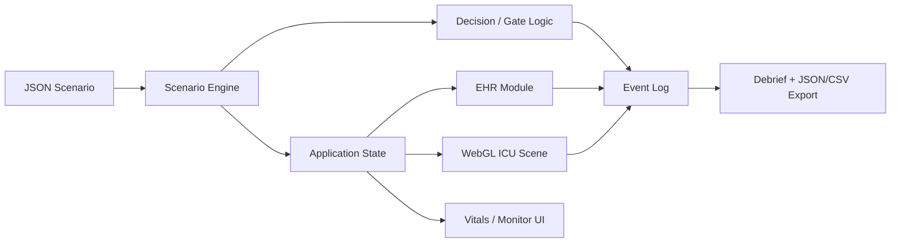
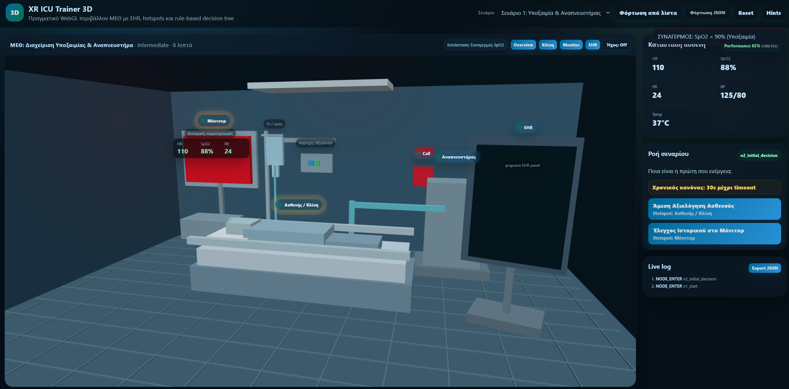
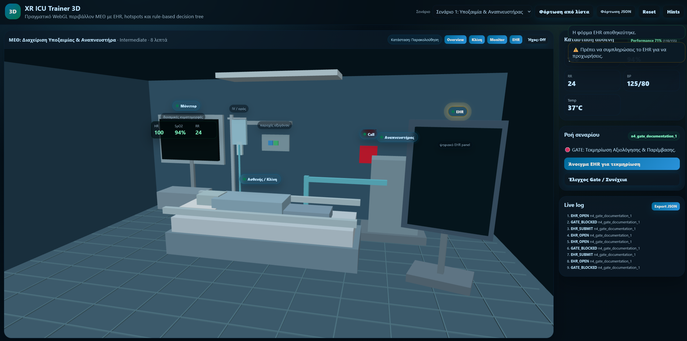
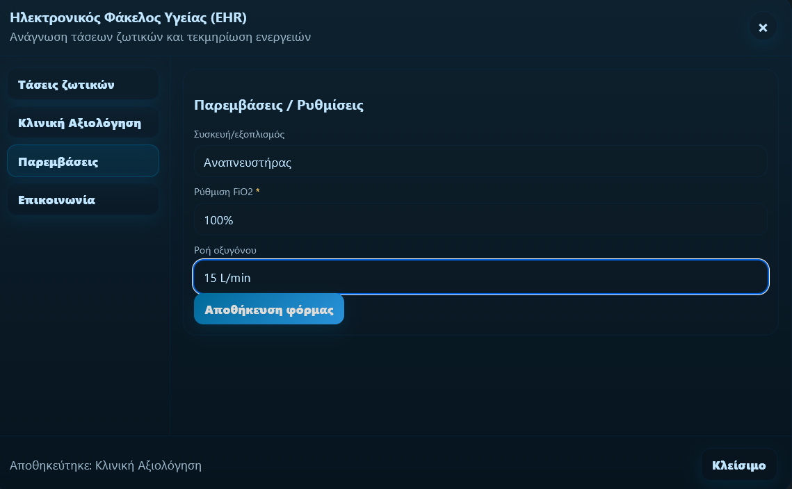
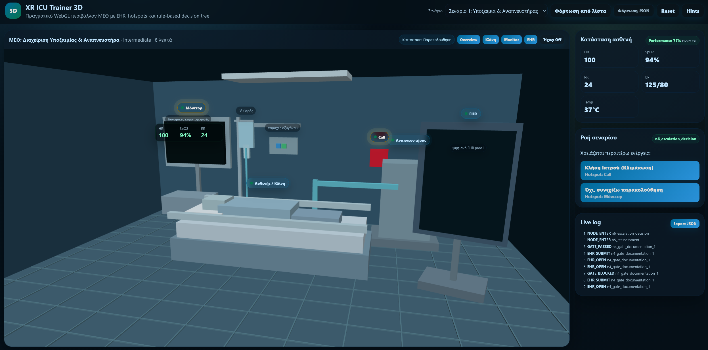
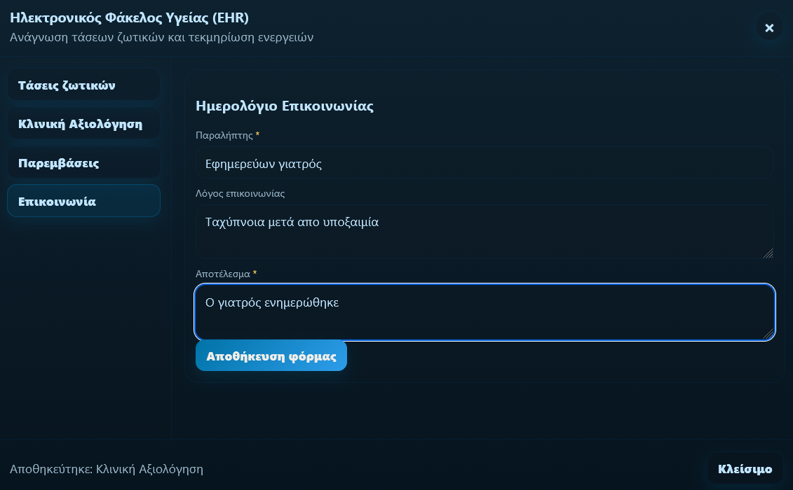
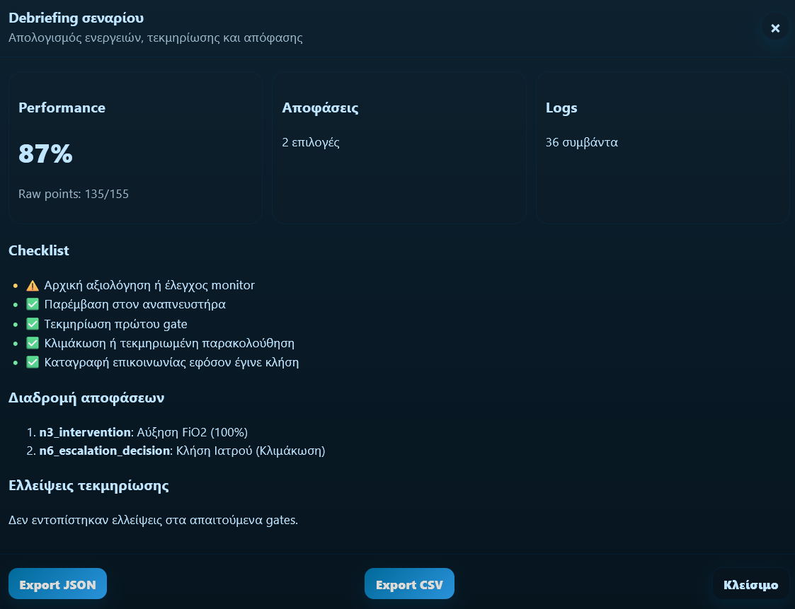

# XR ICU Trainer 3D

A browser-based **3D ICU training simulator** built with vanilla JavaScript and a custom WebGL renderer. The application loads rule-based clinical scenarios from JSON, presents interactive 3D hotspots and EHR documentation gates, tracks user decisions and state changes, and produces a final debrief with exportable logs.

> **Academic team project:** this repository is a cleaned portfolio copy of a university project developed by a five-member team. It demonstrates the shared system and does **not** imply sole authorship of every component.
>
> **Educational use only:** this is a simulation project created for Human-Computer Interaction coursework. It is **not a medical device** and must not be used for clinical decision-making.



## Highlights

- Custom **WebGL 3D renderer** without an external 3D engine
- Interactive ICU scene with camera controls and projected 3D hotspots
- Data-driven **JSON scenario engine** with branching decisions
- Scenario node types for messages, decisions, documentation gates and endings
- Rule/effect system for score, flags, vital-sign changes and UI feedback
- Timed decisions and global rules
- EHR-style forms with validation and documentation gates
- Live event logging and final debrief
- JSON/CSV log export
- Two interchangeable clinical simulation scenarios
- Responsive browser UI with no frontend framework dependency

## Tech Stack

| Area | Technologies |
| --- | --- |
| 3D / Rendering | WebGL, GLSL-style shader pipeline, custom matrix utilities |
| Application | JavaScript, HTML5, CSS3 |
| Scenario data | JSON |
| Local serving | Python 3 standard library HTTP server |
| UI concepts | Dialogs, forms, hotspots, state-driven rendering, responsive layout |

## System Overview



A scenario defines its initial state, hotspots, EHR forms, rules and decision-tree nodes. The JavaScript runtime initializes state from the selected JSON file, renders the current node, applies effects to flags/vitals/score and records user interactions in the event log.

For a more detailed breakdown, see [Architecture](docs/ARCHITECTURE.md).

## Screenshots

### Timed decision



### Documentation gate



### EHR intervention form



### Escalation decision



### Communication log



### Debrief



## Running Locally

### Requirements

- Python 3.x
- A modern browser with WebGL support

No third-party Python or JavaScript packages are required.

### Start the local server

```bash
python run_server.py
```

Then open:

```text
http://127.0.0.1:8000
```

Using a local HTTP server is required because the application loads scenario JSON files through browser `fetch` requests.

## Scenarios

The project includes two JSON scenarios:

```text
scenarios/
├── icu_scenario_hypoxia_v1.json
└── icu_scenario_fever_hypotension_v1.json
```

Each scenario can define:

- metadata and learning goals
- initial vitals and flags
- active 3D hotspots
- EHR form configuration
- global rules
- decision-tree nodes and options
- timeouts
- state/vitals/score effects
- logging and debrief configuration

The application can also load a compatible scenario JSON file from the UI.

## Core Runtime Flow

```text
Load scenario
    ↓
Initialize state / vitals / flags / EHR / log
    ↓
Enter current node
    ↓
Render message, decision, gate or end node
    ↓
User interacts with UI / 3D hotspot / EHR
    ↓
Apply effects + evaluate rules
    ↓
Record event
    ↓
Move to next node
    ↓
Debrief + export
```

## Project Structure

```text
icu-webgl-simulator/
├── index.html
├── app.js
├── styles.css
├── run_server.py
├── scenarios/
│   ├── icu_scenario_hypoxia_v1.json
│   └── icu_scenario_fever_hypotension_v1.json
├── docs/
│   ├── ARCHITECTURE.md
│   ├── Technical_Manual_3D.pdf
│   ├── User_Manual_3D.pdf
│   └── screenshots/
├── NOTICE.md
├── .gitignore
└── README.md
```

## Documentation

- [Architecture notes](docs/ARCHITECTURE.md)
- [Technical manual](docs/Technical_Manual_3D.pdf)
- [User manual](docs/User_Manual_3D.pdf)

The PDF manuals in this portfolio copy have been sanitized to remove student registration numbers and team-member personal details from the cover page.

## What This Project Demonstrates

From a software-engineering perspective, the project demonstrates experience with:

- event-driven browser application logic
- state management without a framework
- 3D graphics fundamentals and camera transforms
- configuration-driven application behavior
- branching workflows and rule evaluation
- form validation and gating
- structured event logging
- modular scenario data separated from runtime logic
- UX/HCI-oriented interaction design

## Academic / Authorship Note

This project was produced collaboratively as a five-person university team assignment. The repository is presented as a portfolio copy of the **shared implementation**. It should not be interpreted as a claim that the repository owner individually authored every module.

No open-source license is attached because the original work was collaborative. Permission from the other contributors and any applicable university/course policy should be confirmed before redistributing or licensing the code beyond portfolio display.
