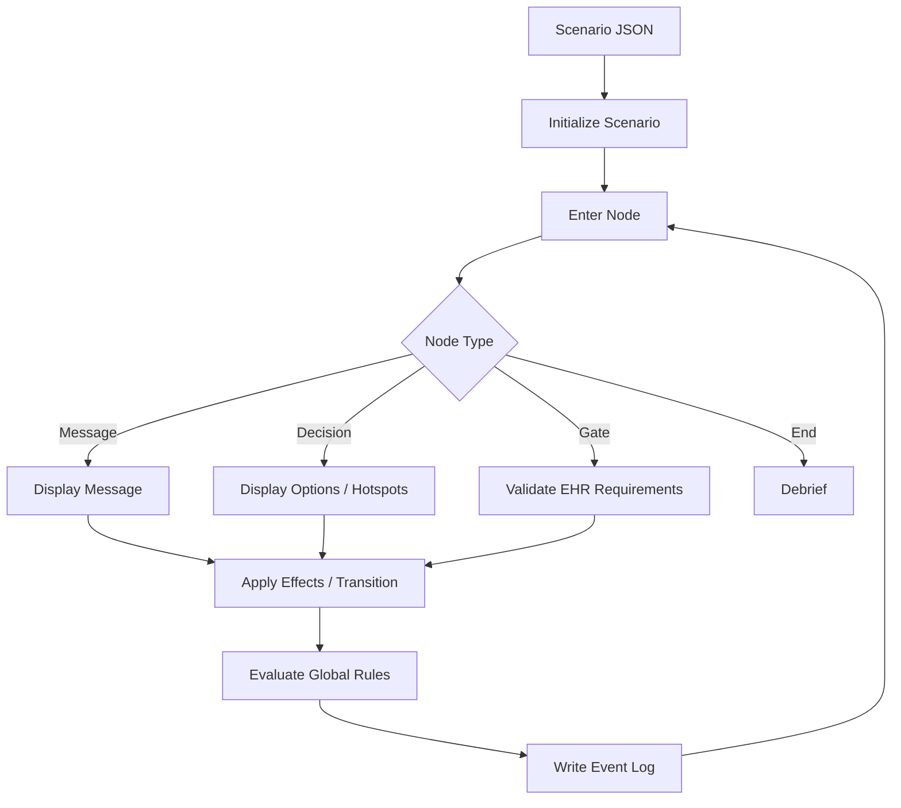

# Architecture Notes

## 1. Application Shell

The application is a single-page browser experience composed of:

- a WebGL canvas for the 3D ICU room
- a projected hotspot layer for object interaction
- a scenario/control panel
- EHR dialogs and forms
- monitor/vitals visualizations
- live event log and debrief dialogs

`index.html` defines the application shell, while `styles.css` contains the responsive presentation and `app.js` contains the renderer and scenario runtime.

## 2. WebGL Layer

The project implements its own lightweight rendering pipeline instead of using Three.js or another 3D engine. `app.js` contains:

- matrix identity/multiplication utilities
- translation, scaling and rotation transforms
- perspective projection
- look-at camera calculation
- shader compilation
- cube geometry/buffers
- scene-object construction
- camera movement and preset views
- projection of 3D object locations into screen-space hotspot positions

The application also renders monitor/waveform information on a separate 2D canvas.

## 3. Scenario Engine

Clinical simulation behavior is data-driven. JSON scenario files provide:

- `scenario_meta`
- `initial_state`
- `hotspots`
- `ehr_config`
- `rules`
- `nodes`
- `logging`
- optional debrief configuration

At runtime, the application initializes a scenario state and enters the first node. Depending on node type, the UI presents a message, decision, documentation gate or ending state.

Options can apply effects such as:

- score changes
- flag/state updates
- vital-sign updates
- UI notifications
- transitions to another node

Timed nodes can also apply effects and transition automatically when a timeout expires.

## 4. State and Rules

The runtime maintains scenario state including current score, flags, vitals, EHR data, trends, log entries and the current node.

Global rules are evaluated against state values. The code supports condition checks such as threshold comparisons and uses path-based accessors to read/write nested state values.

## 5. EHR and Documentation Gates

The EHR module builds forms from scenario configuration. Gate nodes can require specific fields to be completed before the scenario can continue.

This creates a workflow in which progress depends not only on selecting an action, but also on documenting the required information.

## 6. Logging and Debrief

The application records structured events including scenario navigation, hotspot interactions, option selection, EHR submissions, gate outcomes and vital-sign changes.

At the end of a scenario, a debrief view summarizes performance and supports exporting the event history as JSON or CSV.

## 7. Extensibility

A key design choice is the separation of scenario data from runtime logic. A compatible new scenario can be added primarily through JSON rather than by rewriting the application shell.

